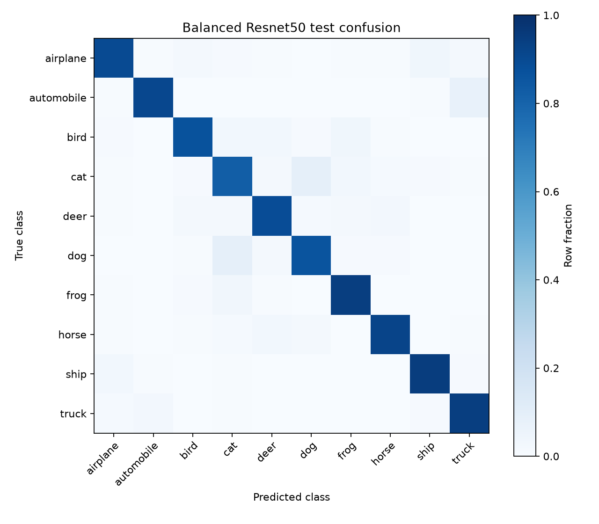
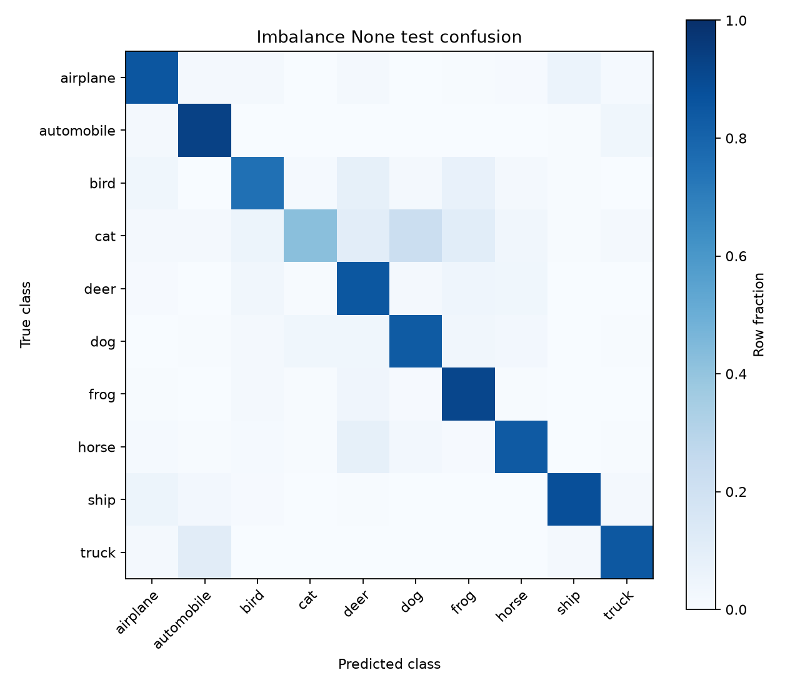
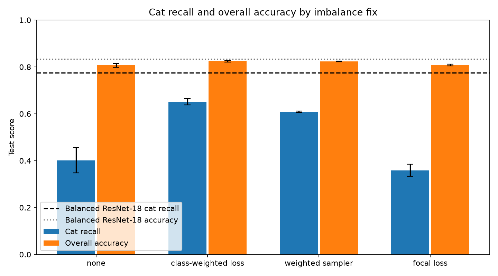

# CIFAR-10 test results

Reducing class 3 (cat) to 10% lowers cat recall by 0.373 relative to the balanced ResNet-18 seed-42 run.
class-weighted loss recovers the most cat recall among the fixes (+0.250 versus no fix); overall accuracy changes by +0.018, while dog recall shifts by -0.078.
The overall accuracy and cat-recall means are averaged across three seeds for each imbalanced fix; error bars show sample standard deviation.
Weighted-loss and sampler overall accuracy differ by 0.001, below their seed standard deviations (0.004 and 0.002); this ranking is smaller than the seed spread.
Both balanced backbones have a single seed, so they provide references without a variability estimate.

| Run | Backbone | Fix | Seed | Accuracy | Macro-F1 | Macro recall | Cat recall | Cat precision |
|---|---|---|---:|---:|---:|---:|---:|---:|
| runs/sweeps/cifar_baseline/resnet18__3ecc064117/seed_42/20261028-152604-617592-resnet18 | resnet18 | balanced | 42 | 0.8337 | 0.8342 | 0.8337 | 0.7750 | 0.6828 |
| runs/sweeps/cifar_baseline/resnet50__7c60af6bd0/seed_42/20261028-152834-577511-resnet50 | resnet50 | balanced | 42 | 0.9005 | 0.9007 | 0.9005 | 0.8240 | 0.7946 |
| runs/sweeps/cifar_imb_none/resnet18__3ecc064117/seed_0/20261028-153336-779542-resnet18 | resnet18 | none | 0 | 0.8115 | 0.8055 | 0.8115 | 0.4220 | 0.8630 |
| runs/sweeps/cifar_imb_none/resnet18__3ecc064117/seed_1/20261028-153604-232749-resnet18 | resnet18 | none | 1 | 0.8110 | 0.8019 | 0.8110 | 0.3410 | 0.9118 |
| runs/sweeps/cifar_imb_none/resnet18__3ecc064117/seed_2/20261028-153753-693301-resnet18 | resnet18 | none | 2 | 0.7978 | 0.7934 | 0.7978 | 0.4420 | 0.8403 |
| runs/sweeps/cifar_imb_weighted/resnet18__3ecc064117/seed_0/20261028-153938-805166-resnet18 | resnet18 | class-weighted loss | 0 | 0.8252 | 0.8247 | 0.8252 | 0.6560 | 0.7069 |
| runs/sweeps/cifar_imb_weighted/resnet18__3ecc064117/seed_1/20261028-154128-476169-resnet18 | resnet18 | class-weighted loss | 1 | 0.8282 | 0.8273 | 0.8282 | 0.6360 | 0.7518 |
| runs/sweeps/cifar_imb_weighted/resnet18__3ecc064117/seed_2/20261028-154324-961000-resnet18 | resnet18 | class-weighted loss | 2 | 0.8196 | 0.8199 | 0.8196 | 0.6620 | 0.6769 |
| runs/sweeps/cifar_imb_sampler/resnet18__3ecc064117/seed_0/20261028-154536-036382-resnet18 | resnet18 | weighted sampler | 0 | 0.8248 | 0.8235 | 0.8248 | 0.6070 | 0.7304 |
| runs/sweeps/cifar_imb_sampler/resnet18__3ecc064117/seed_1/20261028-154735-969474-resnet18 | resnet18 | weighted sampler | 1 | 0.8242 | 0.8231 | 0.8242 | 0.6120 | 0.7602 |
| runs/sweeps/cifar_imb_sampler/resnet18__3ecc064117/seed_2/20261028-154923-821643-resnet18 | resnet18 | weighted sampler | 2 | 0.8213 | 0.8198 | 0.8213 | 0.6060 | 0.7249 |
| runs/sweeps/cifar_imb_focal/resnet18__3ecc064117/seed_0/20261028-155145-723110-resnet18 | resnet18 | focal loss | 0 | 0.8113 | 0.8040 | 0.8113 | 0.3850 | 0.8912 |
| runs/sweeps/cifar_imb_focal/resnet18__3ecc064117/seed_1/20261028-155409-104026-resnet18 | resnet18 | focal loss | 1 | 0.8087 | 0.8008 | 0.8087 | 0.3590 | 0.8930 |
| runs/sweeps/cifar_imb_focal/resnet18__3ecc064117/seed_2/20261028-155643-495715-resnet18 | resnet18 | focal loss | 2 | 0.8036 | 0.7949 | 0.8036 | 0.3330 | 0.8928 |

| Fix | Missed cat predicted as (mean count per 1,000 cats) |
|---|---|
| none | dog 26.7, deer 8.6, frog 8.6, bird 6.8, horse 3.2, airplane 2.1, truck 1.8, automobile 1.2, ship 0.8 |
| class-weighted loss | dog 13.8, deer 6.2, frog 4.9, bird 4.8, horse 1.7, truck 1.2, airplane 1.0, ship 0.7, automobile 0.6 |
| weighted sampler | dog 16.3, deer 6.1, frog 5.5, bird 5.0, horse 2.5, truck 1.2, airplane 1.0, automobile 0.7, ship 0.7 |
| focal loss | dog 31.7, deer 8.3, bird 7.8, frog 7.7, horse 3.4, airplane 2.0, truck 1.5, automobile 0.9, ship 0.8 |

