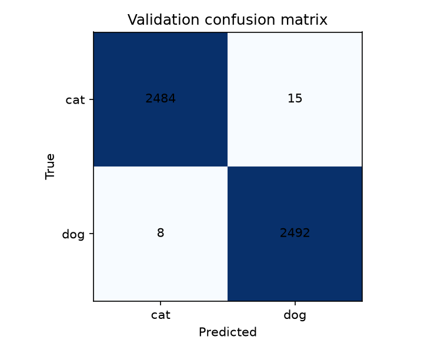
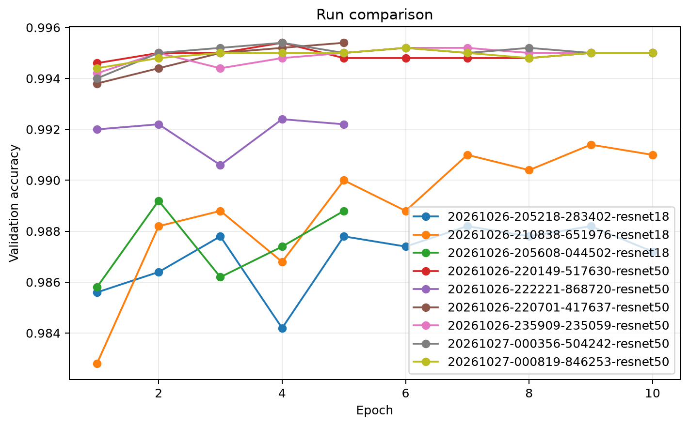
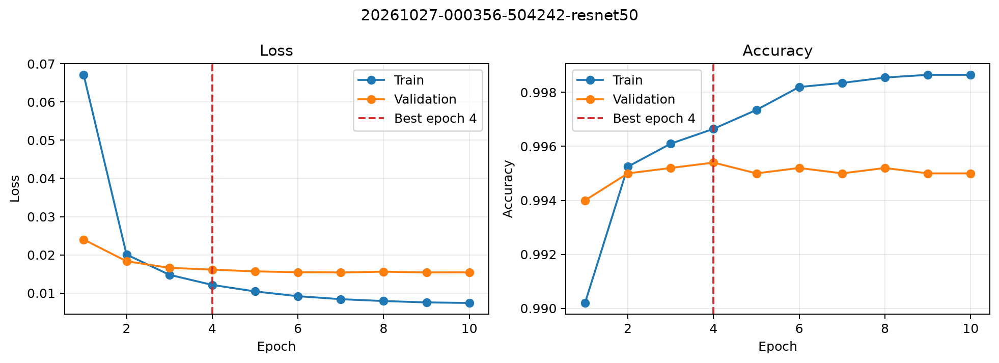

# Best configuration results

These results use the ResNet-50 frozen configuration selected in [the baseline sweep](sweep_results.md). The three owner-run seeds are complete, and each run has a validation completion marker. The selected best seed is seed 1; its checkpoint was reevaluated on validation and used for the unlabeled test submission.

## Validation across seeds

| Seed | Validation accuracy |
|---:|---:|
| 0 | 0.995199 |
| 1 | 0.995399 |
| 2 | 0.995199 |
| **Mean ± standard deviation** | **0.995266 ± 0.000115** |

The mean and population standard deviation are from `runs/seeds/best/summary.csv`. Seed 1 is the best checkpoint by validation accuracy (0.995399).

## Best-seed validation

The seed 1 reevaluation contains 4,999 validation images and reached 0.995399 accuracy. Rows are true classes in `[cat, dog]` order and columns are predicted classes in that order:

| True \ Predicted | Cat | Dog |
|---|---:|---:|
| Cat | 2,484 | 15 |
| Dog | 8 | 2,492 |

## Incorrect cases

The highest-confidence cat-to-dog errors often show multiple animals or a dog sharing the frame with the cat, so the image contains competing animal cues. Some examples are dark, blurry, or low resolution, which makes the visible animal harder to identify. The dog-to-cat gallery includes many young puppies and close crops where fur and face shape dominate while the full body is hidden. These are patterns in the five most confident errors per class, not a measured explanation of every mistake; ambiguous framing and possible annotation noise are plausible contributors.

The galleries show dataset photos, so they are not committed to this public repo. They are in
`runs/report/issue23/galleries/` (`best_seed_incorrect_cats.png`, `best_seed_incorrect_dogs.png`)
and in seed 1's run folder.

## Run figures and test submission

The comparison figure covers the six baseline sweep runs and all three seed runs. Per-run training curves and comparison tables are retained in `runs/report/issue23/` and the original run folders; the report-ready copies are in `docs/figures/`.

The root [`submission.csv`](../submission.csv) has the required `id,label` header and 500 test-image rows sorted by numeric ID. Labels use 1 for dog and 0 for cat. Predictions were produced by seed 1's `best.pt` without test-time augmentation.
